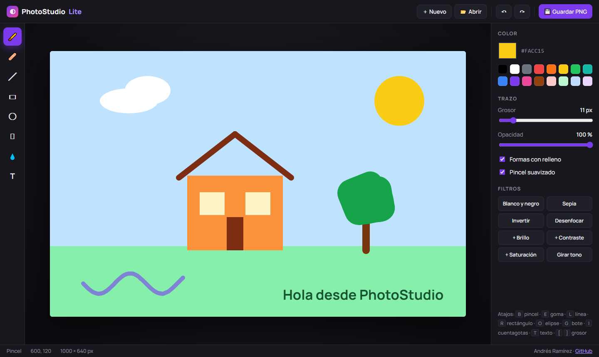

# PhotoStudio Lite

Editor de dibujo e imagen que funciona por completo en el navegador, construido sobre la **API de Canvas** sin librerías.

**[▶ Abrir el editor](https://ramizzz8.github.io/photostudio-lite/)**

## Herramientas

| Herramienta | Atajo | Qué hace |
| --- | :---: | --- |
| Pincel | <kbd>B</kbd> | Trazo libre suavizado con curvas cuadráticas |
| Goma | <kbd>E</kbd> | Borra pintando el color del fondo |
| Línea | <kbd>L</kbd> | Línea recta con previsualización mientras arrastras |
| Rectángulo y elipse | <kbd>R</kbd> <kbd>O</kbd> | Con contorno o rellenas |
| Bote de pintura | <kbd>G</kbd> | Relleno por inundación con tolerancia de color |
| Cuentagotas | <kbd>I</kbd> | Toma el color de cualquier punto del lienzo |
| Texto | <kbd>T</kbd> | Escribe directamente sobre el lienzo |

Además: color con paleta rápida, grosor (<kbd>[</kbd> <kbd>]</kbd>), opacidad, **deshacer y rehacer** (<kbd>Ctrl</kbd>+<kbd>Z</kbd> / <kbd>Ctrl</kbd>+<kbd>Y</kbd>), **filtros** (blanco y negro, sepia, invertir, desenfoque, brillo, contraste, saturación y tono), abrir imágenes (o arrastrarlas al lienzo) y exportar a PNG (<kbd>Ctrl</kbd>+<kbd>S</kbd>). Funciona con ratón, lápiz y pantallas táctiles.

## Detalles técnicos

- **Dos lienzos superpuestos**: el de abajo guarda el dibujo y el de arriba muestra la previsualización de formas y trazos mientras arrastras. Así la opacidad de un trazo no se acumula donde se cruza consigo mismo.
- **Historial** de hasta 40 estados con `getImageData` / `putImageData`.
- **Bote de pintura** con el algoritmo *scanline flood fill*: rellena filas enteras y usa una pila en lugar de recursión, para no desbordar con áreas grandes.
- **Filtros** redibujando el lienzo sobre sí mismo con `ctx.filter`.
- **Pointer Events** para tratar igual el ratón, el lápiz y el dedo, convirtiendo las coordenadas al tamaño real del lienzo aunque se muestre escalado.

## Tecnologías

JavaScript · Canvas API · Pointer Events · HTML · CSS

## Cómo ejecutarlo

No necesita instalación: abre `index.html` en el navegador o usa la [demo en vivo](https://ramizzz8.github.io/photostudio-lite/).

## Autor

**Andrés Ramírez** — [GitHub](https://github.com/Ramizzz8) · [LinkedIn](https://www.linkedin.com/in/andr%C3%A9s-ram%C3%ADrez-011936349/)
